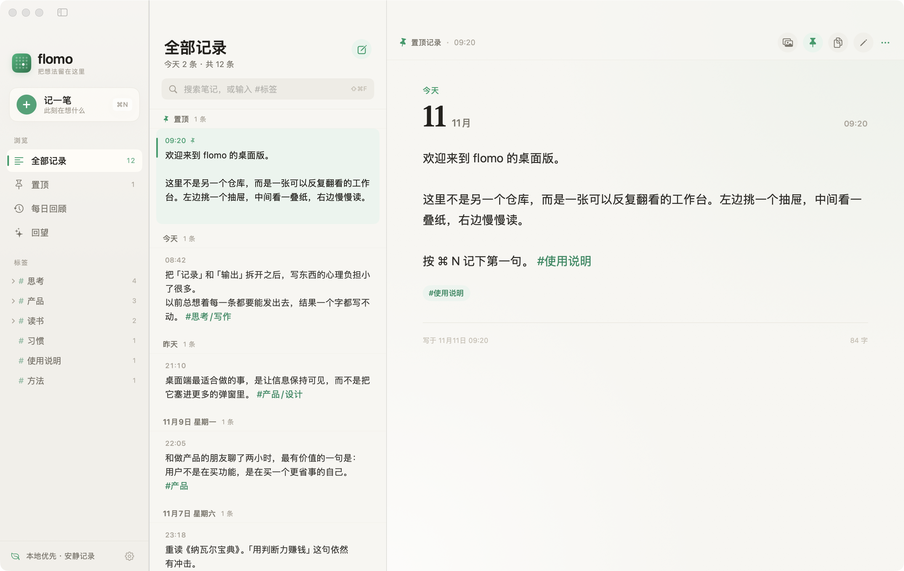

# Sideleaf

本地优先的 macOS 笔记工作台。随手记下想法，回顾旧笔记，再把零散素材写成文章。

A local-first macOS workspace for capturing ideas, revisiting notes, and turning them into drafts.

[中文](#中文) · [English](#english)

<details>
<summary>早期界面预览 · Early UI preview</summary>



</details>

## 中文

### 功能

- **快速记录**。从菜单栏打开记录窗口，用标签组织笔记，按正文或标签搜索。
- **每日回顾**。重读旧笔记，在「回望」里查看近期记录的主题和变化。
- **文章与待办**。用带预览的 Markdown 编辑器整理草稿，用截止日期和子任务推进待办。
- **备份与导出**。导入和导出 Markdown 笔记，也可以把整个工作区导出为备份。

### 从源码运行

需要 macOS 14 或更高版本，以及 Swift 6 工具链。

```bash
git clone https://github.com/EternalHunters/flomo_mac.git
cd flomo_mac
swift run FlomoMac
```

在应用里按 `⌘N` 新建笔记，按 `⇧⌘F` 搜索笔记。

如果需要打包 `.app`，[构建脚本](scripts/build_app.sh) 会生成 `dist/Sideleaf.app`。打包时需要同级 `flomo_ios` 项目中的共享图标，直接用 SwiftPM 运行只需要这个仓库。

### 本地数据与联网功能

笔记、每日回顾、文章和待办保存在本地 SwiftData 数据库 `~/Library/Application Support/flomo-mac/flomo.store`。

- **同步**需要配置自己的同步服务地址并登录。
- **AI 回望**可以从近期笔记中整理文章思路。你确认发送后，应用才会把本次展示范围内的笔记文字和日期发给你配置的 OpenAI 兼容接口。API key 存在 macOS 钥匙串里。
- **腾讯网盘备份**需要在本机安装并登录 `tdrive`。

## English

### Features

- **Quick capture.** Capture ideas from the menu bar, organize notes with tags, and search by text or tag.
- **Daily review.** Revisit older notes and explore recurring themes and changes in recent writing.
- **Articles and to-dos.** Develop drafts in a Markdown editor with a preview, and track tasks with due dates and subtasks.
- **Backup and export.** Import and export notes as Markdown, or export a full workspace backup.

### Run from source

Requires macOS 14 or later and a Swift 6 toolchain.

```bash
git clone https://github.com/EternalHunters/flomo_mac.git
cd flomo_mac
swift run FlomoMac
```

In the app, press `⌘N` to create a note or `⇧⌘F` to search.

The [build script](scripts/build_app.sh) packages `dist/Sideleaf.app` and needs the shared icon from the sibling `flomo_ios` project. Running with SwiftPM only requires this repository.

### Local data and online features

Notes, daily reviews, articles, and to-dos live in a local SwiftData store at `~/Library/Application Support/flomo-mac/flomo.store`.

- **Sync** requires a configured sync server and a signed-in account.
- **AI review** helps turn recent notes into article ideas. When you confirm a request, the app sends the indicated notes’ text and dates to your configured OpenAI-compatible endpoint. The API key is stored in macOS Keychain.
- **Tencent Drive backup** requires the `tdrive` CLI to be installed and signed in.
